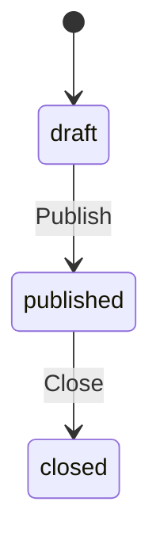

# 自建表單設計服務 V1 — Domain Specification

| 項目 | 內容 |
| --- | --- |
| 版本 | 1.0 |
| 日期 | 2026-09-28 |
| 狀態 | 正式規格 |
| 職責 | 定義 V1 的業務實體、狀態、行為、權限、驗證與資料語意 |
| 配套文件 | [Database](02-v1-database-specification.md)、[API Common](03a-v1-api-contract-common.md)、[API Auth／User／Form](03b-v1-api-contract-auth-user-form.md)、[API Submission／Statistics](03c-v1-api-contract-submission-statistics.md)、[Errors](04-v1-error-catalog.md)、[Constraints](05-v1-system-constraints.md) |

## 1. 文件目的與適用範圍

本文件是自建表單設計服務 V1 的 Domain 規格，定義系統必須維持的業務行為，不指定 Controller、Service、Repository、交易 API 或其他程式結構。

本文中的「必須」、「不得」及「只允許」屬必要規則。程式實作者可以自行選擇內部架構與技術手段，但不得改變本文描述的外部行為、狀態邊界、資料語意與隱私限制。

## 2. 領域模型與名詞

| 名詞 | 定義 |
| --- | --- |
| User | 系統內部會員；所有登入方式最後都對應同一種內部身分 |
| User Identity | 外部登入來源與 User 的對應；V1 僅支援 Google |
| Form | 由會員建立及擁有的表單 Aggregate，管理定義、生命週期與結果政策 |
| Question | Form 中的題目；type 決定 config、選項適用性與答案格式 |
| Option | Choice Question 的選項；id 用於答案識別，label 用於顯示，value 表示業務語意 |
| Submission | 使用者送出一份表單的操作，不是獨立資料實體 |
| Response | 一次成功 Submission 所形成的不可變紀錄 |
| Answer | 某份 Response 對某一 Question 的答案 |
| Effective Response | 同一 Form + User 中，用於最新回覆與 Statistics 的有效完整回覆 |
| Statistics | 由 Effective Responses 即時計算的題目分布，不是獨立持久化實體 |

Owner／Creator 與 Respondent 是 User 相對於特定 Form 的關係，不是全域角色。V1 不設 RBAC、團隊、組織、共同擁有權或管理員功能。Form Owner 可以填寫自己的表單，但仍受一般提交規則限制。

## 3. 共通文字與數值語意

### 3.1 一般文字

- 一般文字輸入移除頭尾符合 Unicode Property `White_Space=Yes` 的字元。
- 不移除文字中間的空白，不合併連續空白，不自動轉換大小寫。
- 不進行 Unicode normalization；視覺相近但實際碼點不同的文字可以是不同值。
- 欄位長度依 Unicode code point 數量計算。
- Nullable description 經 trim 後若為空字串，統一保存為 `null`。
- Password 是例外：不 trim、不進行 Unicode normalization，依使用者原始輸入驗證。

### 3.2 文字等值與排序

- Email 在 trim 後轉成小寫，再進行儲存、登入查找與唯一性比較。
- Option value 與 Text Answer 均採大小寫敏感比較。
- 不進行自然語言、重音符號或文化語系的模糊等值處理。
- 需要穩定排序文字時，採固定、大小寫敏感的 ordinal／binary 語意，不依伺服器作業系統語系改變。

例如 `Apple` 與 `apple` 是不同值。

### 3.3 數值

- 僅接受合法且有限的 JSON number；不接受 `NaN` 或 `Infinity`。
- `1` 與 `1.0` 視為相同數值。
- 驗證、儲存及 Statistics 不得暗中四捨五入或截斷。
- V1 不額外規定 Answer 小數位數；超過系統可安全處理範圍的輸入必須拒絕，不得改值後保存。
- 程式實作者選擇的數值表示方式必須在 Validation、JSONB 與 Statistics 間維持一致。

## 4. User 與 Authentication（USR）

### USR-01：內部身分

業務身分固定使用 `users.id`。Form 擁有者與 Response 填答者都參照此內部 User ID；不得以 email、Google `sub` 或其他外部識別取代內部主鍵。

### USR-02：Email 與 Profile

- Email trim、轉小寫後全系統唯一。
- `displayName` trim 後必須非空，最長 100 個 Unicode code points，不必唯一。
- 使用者可以修改自己的 `displayName`。
- V1 不提供修改 email 或 avatarUrl 的一般 Profile API。
- User 狀態為 `active` 或 `disabled`。
- Disabled User 不能使用受保護功能，即使既有 JWT 尚未到期。

### USR-03：Password

- Password 長度為 10～128 個 Unicode code points。
- 允許 Unicode、空白與特殊字元。
- 不強制大小寫字母、數字或特殊符號的組合規則。
- Password 不 trim、不轉大小寫、不進行 Unicode normalization。
- 系統只保存安全雜湊，不保存或記錄明文 Password。

### USR-04：Register 與 Password Login

- Register 建立新 User，但不自動登入、不發出 JWT，也不設定登入 Cookie。
- 任何既有 User 的 email 都不能再次 Register，包括沒有 Password 的 Google-only User。
- Register 不替既有 User 增設 Password。
- Password Login 成功後建立本系統登入狀態。
- Email 不存在、Password 錯誤，或 User 沒有 Password 時，對外使用相同的登入失敗語意。

### USR-05：Google Identity

Google Identity 以 `(provider = google, providerUserId = Google sub)` 唯一識別。

Google ID Token 必須完成簽章、issuer、audience、expiration 與必要安全 Claims 驗證。首次建立 User 時，必須取得已驗證的 email。

| 情境 | 行為 |
| --- | --- |
| 已存在相同 Google Identity | 使用 Identity 對應的 User 登入 |
| 不存在 Identity，且 email 尚未被使用 | 原子建立 User + User Identity，接著登入 |
| 不存在 Identity，但 email 已屬於既有 User | 拒絕登入，不自動合併或綁定帳號 |

建立新 Google User 時：

- Email 使用已驗證的 Google email。
- displayName 優先使用 trim 後非空的 Google name；若缺少，使用 email 的 `@` 前內容。
- Google picture 缺少時，avatarUrl 為 `null`。

既有 Google Identity 再次登入時，以 `sub` 尋找身分，不自動覆寫 User 的 email、displayName 或 avatarUrl。Google 登入本身不具有同步 Profile 的隱藏副作用。

Google-only User 的 `passwordHash` 可以為 `null`。資料模型允許 User 同時具備 Password 與 Google Identity，但 V1 不提供建立、綁定或解除此組合的 API。

### USR-06：登入狀態與 Logout

- 系統 JWT 透過 `access_token` HttpOnly Cookie 傳送。
- JWT `sub` 對應 `users.id`，並驗證 signature、issuer、audience 與 expiration。
- 本系統 JWT 的預設有效時間為自簽發起 24 小時；Server Configuration 可以使用正整數分鐘明確覆寫。V1 無 Refresh Token。
- 受保護請求必須重新確認 User 仍存在且狀態為 active。
- Logout 清除目前 Client 的 Cookie；沒有 Cookie、Cookie 無效或已過期時仍視為成功。
- V1 無 Session Store、Token 撤銷清單或跨裝置強制登出。

## 5. Form Aggregate 與生命週期（FORM）

### FORM-01：Form Definition 邊界

以下資料屬於 Form Definition，只能在 `draft` 狀態修改：

- Form `title`、`description`
- `responseMode`、`responseIdentity`
- `submissionDeadlineAt`
- Question 的 type、title、description、required、sortOrder、config
- Option 的 label、value、sortOrder
- Questions 與 Options 的集合及歸屬關係

`status` 是生命週期狀態；`resultVisibility` 是結果存取政策；`deletedAt` 是 Soft Delete 標記。三者不屬於 Form Definition。

### FORM-02：建立時預設

建立 Form 時：

| 欄位 | 規則／預設 |
| --- | --- |
| title | 必填；trim 後非空；最長 200 個 Unicode code points |
| description | 預設 `null` |
| status | `draft` |
| resultVisibility | `owner_only` |
| responseMode | `single` |
| responseIdentity | `anonymous` |
| submissionDeadlineAt | 預設 `null` |
| questions | 預設空集合 |

Question title 與 Option label 在 trim 後必須非空。V1 不另設欄位專屬最大長度；整體 Request Body 安全限制屬獨立 Capacity Policy。

Option value 在 trim 後必須非空，最長 255 個 Unicode code points，並採大小寫敏感語意。

### FORM-03：生命週期



| 操作 | draft | published | closed |
| --- | --- | --- | --- |
| Owner 編輯 Definition | 允許 | 禁止 | 禁止 |
| Publish | 通過發布驗證後允許 | 重複發布衝突 | 非法狀態轉移 |
| Close | 非法狀態轉移 | 允許 | 重複關閉衝突 |
| Owner 調整 resultVisibility | 允許 | 允許 | 允許 |
| Owner Soft Delete | 允許 | 允許 | 允許 |
| 提交 Response | 禁止 | 視 Deadline 與提交規則 | 禁止 |
| 讀取 Statistics | 禁止 | 禁止 | 視結果存取政策 |

`closed` 是終止狀態；V1 不允許 Reopen 或退回 Draft。表格均以 Form 尚未 Soft Delete 為前提。

### FORM-04：Draft 與 Publish 分階段驗證

Draft 可以不完整，但不能保存結構錯誤或彼此矛盾的內容。

Draft 允許：

- Form 沒有 Question。
- Choice Question 沒有 Option。
- Rating Question 缺少 min 或 max。
- Question config 尚未完成。

Draft 已提供的資料仍必須符合：

- config 是 JSON object，且不含該題型未定義的屬性。
- 已提供欄位的資料型別及個別範圍正確。
- Rating 已提供的 min 或 max 各自是 0～100 的整數；兩者皆有時必須符合 `min < max`。
- 已有的 Option 具備有效 label、value、sortOrder。
- 同一 Question 內的 Option value 不重複。
- Question 與 Option 的 sortOrder 為非負整數，且在各自同一 Parent 下不重複。

Publish 時必須符合完整條件：

1. Form title 有效，且至少包含一個 Question。
2. 所有 Question 的 type、title、config 均完整有效。
3. Single Choice 與 Multiple Choice 各至少包含一個有效 Option。
4. 非 Choice Question 不得包含 Option。
5. Rating 必須同時提供 min、max，並符合 `0 ≤ min < max ≤ 100`。
6. 所有排序與歸屬關係有效。
7. submissionDeadlineAt 若非 `null`，必須嚴格晚於 Publish 當下。

後端不得為缺少的必要設定偷偷補值後 Publish。任何一項失敗時，整個 Publish 不執行。

Question 的 `required` 只決定 Submission 時是否必答，不影響 Question 能否 Publish。

### FORM-05：Definition 更新與 Candidate Definition

Definition 更新以「目前 Draft + 本次變更」形成完整 Candidate Definition，再進行一致性驗證。

- Request 未提及的欄位、Question 或 Option 維持原樣。
- 一般欄位一旦出現即完整取代舊值。
- config 一旦出現即取代整個舊 config，不做逐 key deep merge。
- 只有 nullable 欄位能以明確 `null` 清除。
- 空 PATCH 或空 Delta 集合是合法 no-op，不改變資料或 updatedAt。
- 同一個 Question ID 在一次更新中最多出現一次。
- 同一 Question 內，相同 Option ID 在一次更新中最多出現一次。
- 同一項目不得在一次更新中同時被更新與刪除。
- 未知欄位、唯讀欄位、非法 null 或重複 Delta 都必須拒絕。
- Candidate Definition 驗證或持久化失敗時，不得留下部分變更。

Question／Option Delta 依是否具有 ID 與可修改欄位判定操作：

| Delta 內容 | 操作 |
| --- | --- |
| 沒有 ID | 新增；ID 由 Server 產生 |
| 有 ID，且包含一個以上可修改欄位 | 更新既有項目 |
| 只有 ID | 刪除既有項目 |

未出現在 Delta 中的既有項目維持原樣；空 Delta 集合不是清空集合。

新增 Question：

| 欄位 | 規則／預設 |
| --- | --- |
| type | 必填 |
| title | 必填 |
| sortOrder | 必填 |
| description | 預設 `null` |
| required | 預設 `false` |
| config | 預設 `{}` |
| options | 預設空集合 |

新增 Option 時，label、value、sortOrder 均為必填。

Question Type 變更屬於同一份 Candidate Definition 更新，適用下列規則：

- `single_choice` 與 `multiple_choice` 互換時，保留既有 Options，再套用本次明確提供的 Option Delta。
- Choice Type 改為 `text`、`number` 或 `rating` 時，自動刪除該 Question 的全部既有 Options，不要求額外確認。
- 非 Choice Type 改為 Choice Type 時，起始 Options 為空；本次 Patch 可以同時新增 Options。
- 非 Choice Type 互換時，維持無 Options。
- Type 變更但 Request 未提供 config 時，config 重設為 `{}`；若有提供，則以目標 Type 驗證整份 config。
- 目標 Type 為非 Choice，Request 卻同時提供非空 Option Delta，屬互相矛盾的變更，整份 Patch 必須拒絕。
- Type、config 與 Options 的連動變更必須原子完成，不得留下部分狀態。

### FORM-06：排序

- Question sortOrder 在同一 Form 內唯一。
- Option sortOrder 在同一 Question 內唯一。
- sortOrder 是非負整數，可以不連續。
- Array 位置不是正式排序依據。
- DB 不以排序欄位 UNIQUE 取代 Application 對完整 Candidate Definition 的驗證。

### FORM-07：Deadline

`submissionDeadlineAt = null` 表示沒有期限。非 null 時，只有 `serverNow < submissionDeadlineAt` 才能提交；等於 Deadline 即視為已截止。

到期不會自動 Close，也不改變 status。`published + 已到期` 是合法狀態：不能再提交，Owner 仍可讀取 Respondent Count，但 Statistics 必須等 Owner 主動 Close 後才可使用。

### FORM-08：分享與讀取

- 使用 `forms.id` 作為固定分享識別，不新增 shareId。
- 分享識別不授予管理權、填答權或結果權；Server 必須依 User、Form 狀態及政策判定。
- Draft 不提供對外填答或分享能力。
- Form Detail 要求登入。Owner 可以讀取自己的 Draft；其他已登入會員只能讀取 Published 或 Closed Form。
- 他人的 Draft、不存在與已刪除 Form，在一般 Form Detail 查詢中都視為找不到。
- Form Detail 只包含 Form Definition 與中繼資料，不混入他人 Responses、Answers 或 Statistics。
- Form Detail 可以揭露 Creator 的內部 User ID 與目前 displayName；不得揭露 email、外部 Provider Subject 或其他 User Identity 資料。

### FORM-09：Result Visibility

Owner 可以在 Form 尚未刪除時，於 draft、published、closed 任一狀態調整 resultVisibility。

resultVisibility 只決定 Closed Statistics 的存取範圍，不會提前開放 Statistics，也不改變 Form Definition、Response Identity 或提交資格。

### FORM-10：Soft Delete

Owner 可以在任一生命週期 Soft Delete Form，不需要先 Close。刪除只設定 deletedAt，不改變 status。

Soft Delete 後：

- 一般 API 將 Form 視為不存在。
- Owner List 排除該 Form。
- 不再接受 Submission。
- 本人最新 Response、Respondent Count 與 Statistics 均不可讀取。
- Questions、Options、Responses、Answers 仍保留。

V1 不提供復原、垃圾桶、永久刪除或資料清理流程。

Draft Question 與 Option 可以實體刪除。Question 刪除時連動刪除其 Options；發布後禁止刪除 Question 或 Option。

## 6. Question Config（QST）

Question config 必須是 JSON object，不得為 `null` 或 Array。每種 Question Type 只接受表列屬性，未知屬性必須拒絕。Variant 使用產品語意值，不保存特定前端 UI Library 的元件名稱。

| Question Type | 允許的 config | 規則 |
| --- | --- | --- |
| text | `variant?`、`placeholder?`、`minLength?`、`maxLength?` | variant：input／textarea，省略視為 input；長度為非負整數，兩者皆有時 minLength ≤ maxLength |
| number | `placeholder?`、`min?`、`max?` | min／max 為 number，兩者皆有時 min ≤ max；不支援 variant |
| single_choice | `variant?` | radio／select，省略視為 radio |
| multiple_choice | `variant?` | checkbox／multi_select，省略視為 checkbox |
| rating | `variant?`、`min`、`max` | stars／range，省略視為 stars；min／max 為整數；Publish 時符合 `0 ≤ min < max ≤ 100` |

`?` 表示可以省略，不表示接受 JSON null。text、number 與兩種 choice 可以使用空 object。Rating 在 Draft 可以不完整，但 Publish 時必須具有完整有效的 min、max。

只有 single_choice 與 multiple_choice 可以包含 Options。Options 保存在獨立資料實體，不放入 config。同一 Question 內 Option value 必須唯一，不同 Question 可以重複。

V1 不支援：

- defaultValue
- multiple_choice 的 minSelections／maxSelections
- config 未定義的擴充屬性
- 表列以外的 Question Type

JSONB 的可擴充性不代表未知屬性會自動成為產品功能。

## 7. Submission、Response 與 Answer（SUB）

### SUB-01：Submission 前提

成功 Submission 必須同時符合：

1. User 已登入、存在且狀態為 active。
2. Form 存在且尚未 Soft Delete。
3. Form status 為 published。
4. Server Time 嚴格早於 submissionDeadlineAt，或 Form 沒有 Deadline。
5. responseMode 允許本次提交。
6. Request 中的每個 questionId 都屬於該 Form，且不重複。
7. 所有 required Question 都有有效 Answer。
8. 所有提供的 Answer 都符合 Question type 與 config。
9. 所有 Choice Option 都屬於對應 Question；Multiple Choice 不得重複 Option ID。

userId、responseId 與 submittedAt 由 Server 決定，Client 不得指定或冒用。

### SUB-02：Answer Value

| Question Type | Answer value | 驗證 |
| --- | --- | --- |
| text | JSON string | trim 後依 minLength／maxLength 驗證；大小寫敏感 |
| number | JSON number | 符合已設定的 min／max；不得以數字字串代替 |
| rating | JSON integer | `min ≤ value ≤ max` |
| single_choice | Option ID 的 JSON string | 必須是該 Question 的有效 Option ID；不是 Option value 或 label |
| multiple_choice | Option ID 的 JSON string Array | 每個 ID 有效、屬於該 Question，且 Array 內不重複 |

每份 Response 對同一 Question 最多保存一筆 Answer。Multiple Choice 的整個 ID Array 保存於同一筆 Answer。

### SUB-03：未作答與正規化

- 非必填且未作答的 Question 不建立 Answer。
- 不以 JSON null 或 SQL NULL 表示未作答。
- Text Answer 在持久化前 trim；trim 後空字串視為未作答。
- Multiple Choice 空 Array 視為未作答。
- 未作答若發生於 required Question，Submission 失敗；若為 optional Question，則不保存 Answer。
- 正規化後的 Answer 仍必須符合 Question config。

### SUB-04：原子性與不可變性

成功 Submission 必須原子建立 Response 與全部有效 Answers。任何驗證或持久化失敗時，不得留下部分 Response 或部分 Answers。

Response 與 Answer 提交後不可修改或刪除。V1 不提供 Response Draft、Save & Resume、撤回、編輯或獨立 Answer CRUD。

### SUB-05：Response Mode

| Mode | 行為 |
| --- | --- |
| single | 同一 Form + User 最多一個成功 Response；並行請求也最多一個成功 |
| multiple | 每次成功都建立新的 Response + Answers；保留歷史且不覆寫，沒有 Max N 限制 |

single 的一次性保證不能破壞 multiple 保存多筆歷史的能力。具體並行控制由程式實作者決定。

### SUB-06：Effective Response

同一 Form + User 依以下排序取第一筆成功 Response：

```text
submittedAt DESC
id DESC
```

ID 是 submittedAt 相同時的固定 tie-break。

Statistics 與本人最新 Response 都採同一套 Effective Response 規則。最新 Response 是一整份有效回覆；若其中沒有回答某個 optional Question，不得從舊 Response 補回該題 Answer。

### SUB-07：本人最新 Response 與 Receipt

- User 只能查詢自己對特定 Form 的最新 Response。
- Published 與 Closed Form 都可以查詢；Deadline 已過不影響既有 Response 讀取。
- Owner 查詢自己的 Draft 時，結果語意為沒有 Response。
- 非 Owner 查詢 Draft 時，Form 視為不存在。
- Form Soft Delete 後不可讀取 Response。
- V1 不提供歷史 Response 清單或 Owner 原始 Response 清單。

Response Receipt 中 Answers 固定依 Question sortOrder ASC、Question ID ASC 排序。只回傳實際存在的 Answers；optional 未作答題目不補 `null`，也不沿用 Client 送出的 Array 順序。

V1 不支援 Idempotency-Key。single 重試依一次性規則拒絕重複；multiple 在網路結果不明時重試可能增加歷史 Response，V1 接受此限制。

## 8. Respondent Count 與 Statistics（STA）

### STA-01：Respondent Count

Owner 可以在未刪除 Form 的 draft、published、closed 任一狀態讀取 Respondent Count。

Respondent Count 是曾成功提交該 Form 的不同 User 數，不是 Response 總筆數。Owner Form List 中的 count 使用相同語意。

Published 期間 Owner 不能讀取他人 Answers 或整體 Statistics。Owner 若自己曾提交，仍可以使用本人最新 Response 功能。

### STA-02：Statistics 可用狀態與存取政策

Statistics 只在 Form 為 closed 且未 Soft Delete 時可用。

| resultVisibility | Owner | 非 Owner Respondent | 其他登入會員 | 未登入訪客 |
| --- | --- | --- | --- | --- |
| owner_only | 允許 | 拒絕（403） | 拒絕（403） | 拒絕（401） |
| respondents | 允許 | 允許 | 拒絕（403） | 拒絕（401） |
| public | 允許 | 允許 | 允許 | 允許 |

Respondent 指至少曾成功提交該 Form 的 User。

對 `owner_only` 與 `respondents` 而言，登入只是必要條件，不代表登入後必然有權讀取；已登入但不符合身分者仍以 403 拒絕。

Public Statistics 不以登入為前提。Request 帶有無效、過期或 Disabled User 的 Cookie 時，該 Cookie 不得阻止 public 存取，呼叫者視為匿名訪客。

Draft Statistics 對 Owner 表示 Statistics 尚不可用；對非 Owner、未登入者及無法形成有效 Owner 身分的呼叫者，Draft Form 視為不存在。

Published Statistics 對任何有效 Active User 表示 Statistics 尚不可用；對未登入、Token 無效或過期、User 不存在或 Disabled User，Published Form 視為不存在。resultVisibility 不會在 Published 階段提前開放 Statistics。

Public Statistics 不要求先讀取受保護的 Form Detail，因此 Statistics 回應必須包含足夠的 Form 與 Question 顯示資料。

### STA-03：Response Identity

| responseIdentity | Statistics 揭露 |
| --- | --- |
| anonymous（預設） | 不含 respondents、不含身分，也不得提供跨 Question 的 Respondent—Answer Mapping |
| identified | 每個 Statistic Item 包含 respondents；每人只包含 id 與目前 displayName |

兩種模式都在內部保存 userId。anonymous 不是未登入提交，也不是資料庫去識別化。Owner 也不能繞過 anonymous 限制。

identified + public 是合法組合，未登入訪客可以看到 Statistics 中的 User ID 與 displayName。Statistics 使用目前的 displayName，不保存提交當下名稱快照，也不回傳 email 或外部 Identity 資料。

同一 Statistic Item 的 respondents 依 displayName ASC、User ID ASC 排序，一次完整回傳，不分頁。

responseIdentity 屬 Form Definition，Publish 後不可修改。Anonymous 限制只保證系統不建立身分投影或跨題 Mapping；不保證使用者自行寫入自由文字的個資無法被辨認。

### STA-04：Count 語意

| 層次 | count |
| --- | --- |
| Form | 有 Effective Response 的不同 User 數 |
| Question | Effective Response 中具有該 Question Answer 的不同 User 數 |
| Statistic Item | Effective Answer 命中該值或 Option 的不同 User 數 |

identified 模式必須滿足：

```text
item.count == item.respondents.length
```

Multiple Choice 中，同一 Respondent 可以出現在多個 Option Item，因此各 Item count 加總可以大於 Question count；同一 Option Item 內不得重複計算同一 Respondent。

### STA-05：各 Question Type 的分布

| Question Type | Statistic Items | 零值項目 | 排序 |
| --- | --- | --- | --- |
| single_choice | 每個已配置 Option | 全部回傳，即使 count = 0 | Option sortOrder ASC |
| multiple_choice | 每個已配置 Option | 全部回傳，即使 count = 0 | Option sortOrder ASC |
| rating | min 到 max 的每個整數 | 全部回傳，即使 count = 0 | value ASC |
| number | 實際出現的相同數值 | 不產生未出現值 | value ASC |
| text | 正規化後的相同文字 | 不產生未出現值 | count DESC，再 value ASC |

Questions 依 sortOrder ASC 回傳。Statistics 永遠是 Array。

Closed Form 即使沒有任何 Respondent，仍是成功的 Statistics 結果：

- Form count 與 Question count 為 0。
- Text／Number statistics 是空 Array。
- Choice／Rating 依完整配置回傳 count = 0 的 Items。

V1 不提供 percentage、skippedCount、平均數、中位數、完成率、配額、目標人數、剩餘人數、Statistics 分頁或預先計算結果。

## 9. 原子性與競爭請求（CON）

### CON-01：必要原子操作

以下操作必須完整成功或完整失敗：

- Google 首次建立 User + User Identity
- 建立 Form + Questions + Options
- 套用完整 Candidate Definition
- Publish／Close 狀態轉移
- 建立 Response + Answers

### CON-02：Submit 與 Close／Delete

同一 Form 發生競爭操作時，必須形成單一可解釋的邏輯先後：

| 先生效的操作 | 必要結果 |
| --- | --- |
| Submit | Submission 可以完成；其後仍可 Close 或 Soft Delete |
| Close | 後續 Submit 必須因 Form 不可提交而失敗 |
| Soft Delete | 後續 Submit 必須將 Form 視為不存在 |

不保證較早抵達伺服器的 HTTP Request 一定先生效；程式實作者必須定義並維持一致的交易判定點。

### CON-03：Patch 與 Publish

| 先生效的操作 | 必要結果 |
| --- | --- |
| Patch | Publish 必須使用 Patch 後的完整 Definition 重新驗證 |
| Publish | 後續 Patch 必須因 Definition 已凍結而失敗 |

不得發生 Publish 成功後，並行中的舊 Patch 又改動 Published Definition。

### CON-04：Submission Time

每次 Submission 只取得一個 Server Time：

```text
submissionTime = server current time
```

此時間同時用於 Deadline 判斷與 Response submittedAt。若判定時尚未到 Deadline，即使交易稍後才 Commit，該 Submission 仍可成功。

### CON-05：並行首次 Google Login

相同 Google Identity 同時首次登入時：

- 最多建立一組 User + User Identity。
- 唯一性衝突後若可讀到相同 Identity，另一個 Request 視為登入既有 User。
- 若只有 email 衝突而沒有相同 Identity，仍屬帳號衝突。
- 不得留下沒有 Identity 的孤立 User。

## 10. 核心用例與驗收對照

| 用例 | 必要成果 | 核心規則 |
| --- | --- | --- |
| Register／Login | 建立 User；另行建立登入狀態 | USR-01～06 |
| Google Continue | 找到既有 Identity 或原子建立新會員；email 碰撞不合併 | USR-05、CON-05 |
| 編輯 Draft | Candidate Definition 完整套用或完整拒絕 | FORM-01、04～06、CON-01、03 |
| Publish／Close | 單向狀態轉移；Publish 後凍結 Definition | FORM-03～07 |
| 分享與 Submission | 身分、狀態、Deadline、Answer 全部有效才建立 Response | FORM-08、SUB-01～05 |
| 查自己最新 Response | 只回目前 User 的最新完整 Response | SUB-06～07 |
| 查 Respondent Count | 計算不同成功填答 User，不揭露 Answers | STA-01、04 |
| 查 Statistics | Closed、Visibility、Identity Privacy 同時成立 | STA-02～05 |
| Soft Delete Form | 一般 API 不再存取，歷史資料仍保留 | FORM-10 |

## 11. V1 範圍排除

V1 不包含：

- 未登入 Submission
- Email Verification
- Forgot／Reset Password
- MFA
- 修改 Email
- 帳號綁定／解綁
- Refresh Token、Session Store、Token 撤銷
- User 刪除
- 團隊、組織、RBAC、共同擁有權
- Form 版本歷史、複製、模板市集
- Import／Export／CSV
- Webhook、Email 通知
- 條件分支、檔案上傳
- Response Draft、Save & Resume
- 撤回、編輯或刪除 Response
- Owner 原始 Response 清單
- Form Password、自訂網域、QR 產生、主題系統
- 分享連結重設或撤銷
- Form Reopen、垃圾桶、復原、永久刪除及資料清理策略
- Statistics 快取、Materialized View、分頁或進階分析指標

## 12. 文件責任邊界

| 文件 | 負責內容 |
| --- | --- |
| Domain Specification | 業務狀態、行為、不變條件、權限與資料語意 |
| Database Specification | Table、Column、Type、Nullability、Default、Key、Constraint、Index 與 Delete Behavior |
| API Contract | Endpoint、Request／Response、驗證順序、HTTP Status 與可觀察行為 |
| Error Catalog | 穩定 Error Code、Detail Code、Status 與觸發條件 |
| System Constraints | 技術基線、安全邊界、實作自由度與驗收限制 |

規則在不同文件間必須採相同語意。若程式實作者發現無法同時滿足的規則，必須先提出影響與修正方案，不得自行選擇其中一份或默默改變產品行為。
