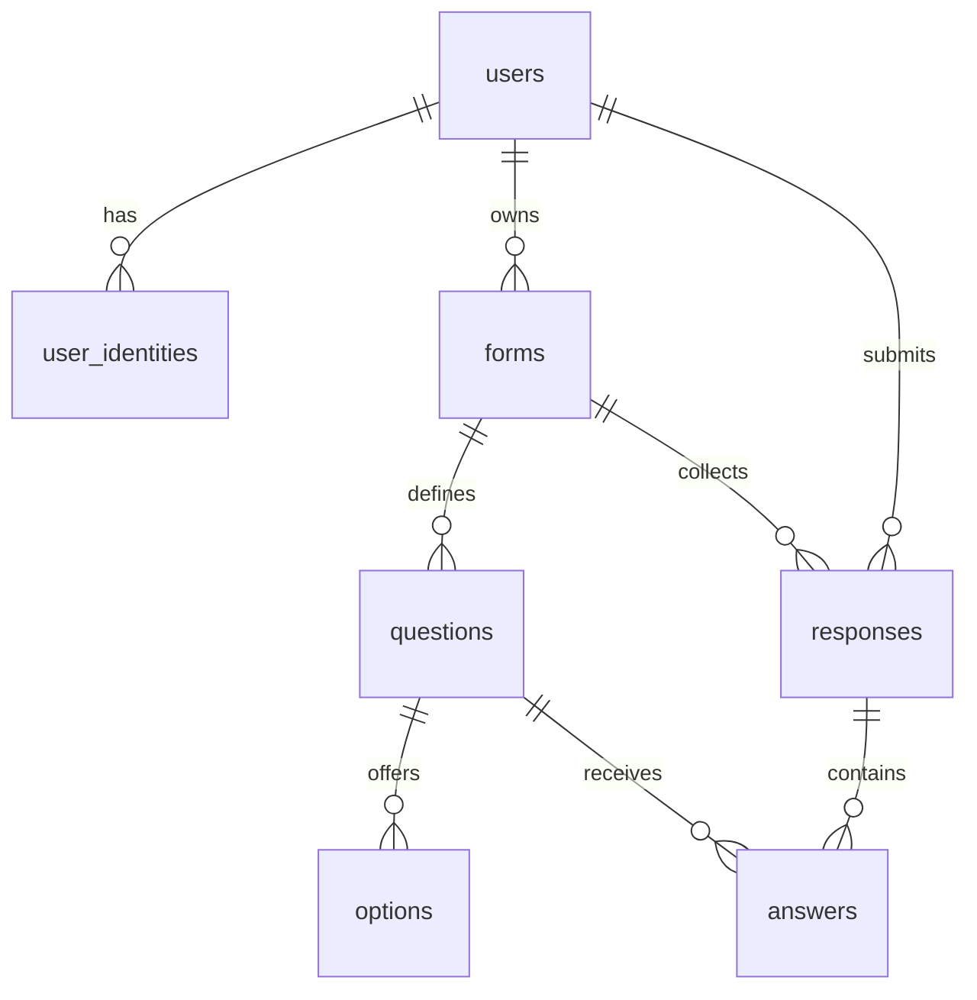

# 自建表單設計服務 V1 — Database Specification

| 項目 | 內容 |
| --- | --- |
| 版本 | 1.0 |
| 日期 | 2026-09-28 |
| 狀態 | 正式規格 |
| 技術基線 | PostgreSQL、EF Core |
| 職責 | 定義 V1 的 7 張 Table、Column、Type、Nullability、Default、Key、Constraint、Index 與 Delete Behavior |
| 配套文件 | [Domain](01-v1-domain-specification.md)、[API Common](03a-v1-api-contract-common.md)、[API Auth／User／Form](03b-v1-api-contract-auth-user-form.md)、[API Submission／Statistics](03c-v1-api-contract-submission-statistics.md)、[Errors](04-v1-error-catalog.md)、[Constraints](05-v1-system-constraints.md) |

## 1. 文件目的與適用範圍

本文件定義自建表單設計服務 V1 的正式資料庫結構。程式實作者可以自行規劃 EF Core Entity、Configuration、Migration、Repository、Query 與 Transaction 寫法，但不得改變本文件定義的 Table／Column 語意、資料型別、Nullability、Default、Constraint、Index 基線或 Delete Behavior。

V1 固定使用以下 7 張 Table：

1. `users`
2. `user_identities`
3. `forms`
4. `questions`
5. `options`
6. `responses`
7. `answers`

Submission 是操作；Statistics 是衍生結果。兩者都不建立獨立 Table。

## 2. Entity Relationship Diagram



ERD 只描述 FK 關係，不表示刪除會全部連動。唯一的正常業務 `ON DELETE CASCADE` 是：

```text
questions.id → options.question_id
```

Choice Answer 保存於 JSONB 內的 Option ID 是經應用層驗證的值，不是額外的實體 FK。

## 3. 共通資料庫約定

### 3.1 命名與編碼

- Table、Column、Constraint 與 Index 命名採 snake_case。
- API 的 camelCase 欄位不得直接改變 DB 命名。
- PostgreSQL Database Encoding 使用 UTF-8。
- `users.email` 在寫入 DB 前已由應用層 trim 並轉成小寫。
- `options.value` 必須維持大小寫敏感等值；不得使用 CITEXT 或大小寫不敏感的 nondeterministic collation 破壞此規則。
- 需要固定文字排序時，Query 或應用層必須採穩定的 ordinal／binary 語意，不依部署環境語系產生不同結果。

### 3.2 ID

- 所有 PK 使用 PostgreSQL `UUID`。
- 公開 API Client 不得指定新資源 ID。
- 新 ID 由 Server 產生並在 Insert 時提供。
- UUID 版本與產生 Library 屬實作選擇，但必須具有足夠唯一性，且不改變 API 的 UUID Contract。

### 3.3 時間

- 所有時間欄位使用 `TIMESTAMPTZ`。
- `created_at`／`updated_at` 若存在，DB Default 為 `now()`。
- `updated_at` 由 Application／ORM 在實際資料變更時更新，不使用 DB Trigger。
- API 正常 Submission 必須將同一個 Server `submissionTime` 同時用於 Deadline 判斷及 `responses.submitted_at`；不得因 DB Default 重新取樣而產生不同時間。
- API 對外時間格式與 UTC 規則由 API Contract 定義。

### 3.4 Default 與 Null

- 表格中的 Default `—` 表示沒有定義 DB Default；不表示字串值，也不表示欄位可以為 NULL。
- Nullable = 是，表示可以保存 SQL NULL。
- JSONB 的 SQL NULL 與 JSON `null` 不相同。
- `questions.config` 不接受 SQL NULL 或 JSON `null`。
- `answers.value` 不接受 SQL NULL；JSON `null` 也不是合法 Answer。

### 3.5 更新與歷史資料

- 不使用 DB Trigger 自動維護 Form Lifecycle、Definition Freeze、Answer Validation 或 Statistics。
- 不為格式一致而替 `responses`／`answers` 新增 created_at、updated_at、deleted_at。
- Form Soft Delete 不實體刪除 Questions、Options、Responses 或 Answers。
- Response／Answer 在 V1 中不可修改或刪除。

## 4. PostgreSQL Enum Types

| Enum Type | 合法值 |
| --- | --- |
| `user_status` | `active`、`disabled` |
| `identity_provider` | `google` |
| `form_status` | `draft`、`published`、`closed` |
| `result_visibility` | `owner_only`、`respondents`、`public` |
| `response_mode` | `single`、`multiple` |
| `response_identity` | `anonymous`、`identified` |
| `question_type` | `text`、`number`、`single_choice`、`multiple_choice`、`rating` |

Enum 的值是 V1 Contract，不得因程式語言命名習慣而改成其他 DB 值。EF Core 的 Enum Mapping 方式由程式實作者決定。

## 5. Table：users

| Column | Type | Nullable | Default | Constraint／用途 |
| --- | --- | --- | --- | --- |
| `id` | UUID | 否 | — | PK |
| `email` | VARCHAR(254) | 否 | — | UNIQUE；正規化後的登入 email |
| `display_name` | VARCHAR(100) | 否 | — | 顯示名稱；不唯一 |
| `avatar_url` | TEXT | 是 | — | 頭像 URL |
| `status` | user_status | 否 | `active` | 會員狀態 |
| `password_hash` | VARCHAR(255) | 是 | — | Password Hash；Google-only User 可為 NULL |
| `created_at` | TIMESTAMPTZ | 否 | `now()` | 建立時間 |
| `updated_at` | TIMESTAMPTZ | 否 | `now()` | 最後更新時間 |

### 5.1 Constraints

- Primary Key：`id`
- Unique：`email`
- FK：無

### 5.2 資料語意

- Application 必須在寫入前完成 email trim、lowercase 與格式驗證，DB Unique 作為最終一致性保護。
- display_name 的 trim、非空及長度規則由 Application 驗證；DB `VARCHAR(100)` 提供儲存上限。
- password_hash 只保存雜湊結果，不保存 Password 明文。
- password_hash 為 NULL 只表示目前沒有 Password Credential，不代表 User 不是有效會員。
- 同一 User 可以同時具有 password_hash 與 Google Identity；不得加入互斥 Check。

### 5.3 不包含的欄位

`users` 不加入：

- username
- role／permission
- google_id
- email_verified_at
- deleted_at
- refresh_token／session 欄位

## 6. Table：user_identities

| Column | Type | Nullable | Default | Constraint／用途 |
| --- | --- | --- | --- | --- |
| `id` | UUID | 否 | — | PK |
| `user_id` | UUID | 否 | — | FK → `users.id` |
| `provider` | identity_provider | 否 | — | V1 為 google |
| `provider_user_id` | VARCHAR(255) | 否 | — | Google ID Token 的 `sub` |
| `created_at` | TIMESTAMPTZ | 否 | `now()` | 建立時間 |
| `updated_at` | TIMESTAMPTZ | 否 | `now()` | 最後更新時間 |

### 6.1 Constraints

- Primary Key：`id`
- Unique：`(provider, provider_user_id)`
- Unique：`(user_id, provider)`
- FK：`user_id → users.id ON DELETE NO ACTION`

### 6.2 資料語意

- `(provider, provider_user_id)` 保證同一外部 Identity 只歸屬一位 User。
- `(user_id, provider)` 保證同一 User 對同一 Provider 最多一筆 Identity。
- 首次 Google Login 建立 User + User Identity 時必須使用同一 Transaction。
- Google 並行首次登入造成唯一性衝突時，不得留下沒有 Identity 的 User。

### 6.3 不保存的外部資料

`user_identities` 不複製保存：

- Provider email
- Provider name
- Provider avatar
- Google access token
- Google refresh token

## 7. Table：forms

| Column | Type | Nullable | Default | Constraint／用途 |
| --- | --- | --- | --- | --- |
| `id` | UUID | 否 | — | PK；同時作為分享識別 |
| `user_id` | UUID | 否 | — | FK → `users.id`；Form Owner |
| `title` | VARCHAR(200) | 否 | — | Form 標題 |
| `description` | TEXT | 是 | — | Form 說明 |
| `status` | form_status | 否 | `draft` | 生命週期 |
| `result_visibility` | result_visibility | 否 | `owner_only` | Closed Statistics 存取政策 |
| `response_mode` | response_mode | 否 | `single` | 單次／多次提交模式 |
| `response_identity` | response_identity | 否 | `anonymous` | Statistics 身分揭露模式；Publish 後凍結 |
| `submission_deadline_at` | TIMESTAMPTZ | 是 | — | NULL 表示沒有 Deadline |
| `created_at` | TIMESTAMPTZ | 否 | `now()` | 建立時間 |
| `updated_at` | TIMESTAMPTZ | 否 | `now()` | 最後更新時間 |
| `deleted_at` | TIMESTAMPTZ | 是 | — | Soft Delete 標記 |

### 7.1 Constraints

- Primary Key：`id`
- FK：`user_id → users.id ON DELETE NO ACTION`

### 7.2 資料語意

- `user_id` 是正式欄位名稱，不改為 owner_user_id。
- 一般查詢只將 `deleted_at IS NULL` 的 Form 視為可存取。
- Soft Delete 只設定 deleted_at，不修改 status，也不實體刪除子資料。
- title、description、response_mode、response_identity、submission_deadline_at 與 Question／Option Tree 屬 Form Definition，只能在 draft 修改。
- result_visibility 不屬於 Form Definition；Form 未刪除時可由 Owner 在任一 status 修改。
- status 只允許 `draft → published → closed`。
- Deadline 到期不自動改變 status。

### 7.3 不包含的欄位

`forms` 不加入：

- published_at／closed_at
- slug／share_id
- max_responses／quota
- statistics cache
- version number／definition history

## 8. Table：questions

| Column | Type | Nullable | Default | Constraint／用途 |
| --- | --- | --- | --- | --- |
| `id` | UUID | 否 | — | PK |
| `form_id` | UUID | 否 | — | FK → `forms.id` |
| `type` | question_type | 否 | — | Question Type |
| `title` | TEXT | 否 | — | Question 標題 |
| `description` | TEXT | 是 | — | Question 說明 |
| `required` | BOOLEAN | 否 | `false` | Submission 時是否必答 |
| `sort_order` | INTEGER | 否 | — | 同一 Form 內的排序值 |
| `config` | JSONB | 否 | `'{}'::jsonb` | Question Type 設定 |
| `created_at` | TIMESTAMPTZ | 否 | `now()` | 建立時間 |
| `updated_at` | TIMESTAMPTZ | 否 | `now()` | 最後更新時間 |

### 8.1 Constraints

- Primary Key：`id`
- FK：`form_id → forms.id ON DELETE NO ACTION`
- Check：`sort_order >= 0`
- Check：`jsonb_typeof(config) = 'object'`

### 8.2 Index

```text
(form_id, sort_order)
```

### 8.3 DB 與 Application 分工

- DB 保證 sort_order 非負，但不建立 `UNIQUE(form_id, sort_order)`。
- Application 必須保證同一 Form 內的 Question sort_order 不重複。
- JSONB Object Check 只保證 config 是 Object；題型屬性、型別、未知欄位、Rating 範圍與 Draft／Publish 完整度由 Application 驗證。
- Published／Closed Question 不得更新或刪除。

## 9. Table：options

| Column | Type | Nullable | Default | Constraint／用途 |
| --- | --- | --- | --- | --- |
| `id` | UUID | 否 | — | PK；Choice Answer 保存此 ID |
| `question_id` | UUID | 否 | — | FK → `questions.id`；ON DELETE CASCADE |
| `label` | TEXT | 否 | — | 顯示文字 |
| `value` | VARCHAR(255) | 否 | — | 大小寫敏感的業務語意值 |
| `sort_order` | INTEGER | 否 | — | 同一 Question 內的排序值 |
| `created_at` | TIMESTAMPTZ | 否 | `now()` | 建立時間 |
| `updated_at` | TIMESTAMPTZ | 否 | `now()` | 最後更新時間 |

### 9.1 Constraints

- Primary Key：`id`
- FK：`question_id → questions.id ON DELETE CASCADE`
- Unique：`(question_id, value)`
- Check：`sort_order >= 0`

### 9.2 Index

```text
(question_id, sort_order)
```

### 9.3 DB 與 Application 分工

- DB 不建立 `UNIQUE(question_id, sort_order)`；Application 必須保證同一 Question 內 sort_order 不重複。
- 只有 single_choice／multiple_choice Question 可以擁有 Options，此跨表規則由 Application 保證。
- Option label／value 的 trim、非空與長度規則由 Application 驗證。
- `UNIQUE(question_id, value)` 必須使用大小寫敏感語意。
- `options.value` 與 `answers.value` 是不同概念；Choice Answer 保存 Option ID，不保存 Option value。

### 9.4 Question Type 變更

Question 從 single_choice／multiple_choice 改成 text／number／rating 時，Application 必須在同一個 Candidate Definition Transaction 中實體刪除該 Question 的全部 Options。

此行為不是 FK Cascade，因為 Question 本身仍存在。Type 更新、Options 刪除與其他 Definition 變更必須一起成功或一起失敗。

single_choice 與 multiple_choice 互相切換時可以保留 Options。非 Choice Type 改成 Choice Type 時，可以在同一操作新增 Options；Draft 也允許暫時沒有 Option。

## 10. Table：responses

| Column | Type | Nullable | Default | Constraint／用途 |
| --- | --- | --- | --- | --- |
| `id` | UUID | 否 | — | PK |
| `form_id` | UUID | 否 | — | FK → `forms.id` |
| `user_id` | UUID | 否 | — | FK → `users.id`；anonymous 仍保存內部 User ID |
| `submitted_at` | TIMESTAMPTZ | 否 | `now()` | 成功 Submission 的 Server Time |

### 10.1 Constraints

- Primary Key：`id`
- FK：`form_id → forms.id ON DELETE NO ACTION`
- FK：`user_id → users.id ON DELETE NO ACTION`

### 10.2 Indexes

```text
(form_id, submitted_at)
(user_id, form_id, submitted_at)
```

### 10.3 資料語意

- Response 存在即代表一次成功 Submission；沒有 Draft 或 status 欄位。
- Response 不加入 created_at、updated_at、deleted_at。
- API Submission 必須明確寫入已用於 Deadline 判定的 submissionTime；`now()` 是 DB Schema Default，不得使正常 API 流程重新取樣時間。
- Effective Response 依同一 `(form_id, user_id)` 下的 `submitted_at DESC, id DESC` 取得。

### 10.4 Single／Multiple Mode

不得無條件建立：

```text
UNIQUE(form_id, user_id)
```

因為 multiple Mode 必須允許同一 User 對同一 Form 保存多筆歷史 Response。

single Mode 的並行一次性仍是必要規則；Application 與 Transaction／Concurrency 機制必須保證同一 Form + User 最多一筆成功 Response。具體方式由程式實作者決定，但不得破壞 multiple Mode。

## 11. Table：answers

| Column | Type | Nullable | Default | Constraint／用途 |
| --- | --- | --- | --- | --- |
| `id` | UUID | 否 | — | PK |
| `response_id` | UUID | 否 | — | FK → `responses.id` |
| `question_id` | UUID | 否 | — | FK → `questions.id` |
| `value` | JSONB | 否 | — | 依 Question Type 保存 Answer |

### 11.1 Constraints

- Primary Key：`id`
- FK：`response_id → responses.id ON DELETE NO ACTION`
- FK：`question_id → questions.id ON DELETE NO ACTION`
- Unique：`(response_id, question_id)`

### 11.2 Index

```text
(question_id)
```

### 11.3 JSONB Value Shape

| Question Type | `answers.value` |
| --- | --- |
| text | JSON string |
| number | JSON number |
| rating | JSON integer |
| single_choice | Option ID 的 JSON string |
| multiple_choice | Option ID 的 JSON string Array；一題一筆 Answer |

### 11.4 資料語意

- 每份 Response 對同一 Question 最多一筆 Answer。
- Optional Question 未作答時不建立 Answer Row。
- 不以 SQL NULL 或 JSON `null` 建立「未作答」資料。
- Text 空字串與 Multiple Choice 空 Array 必須在持久化前依 Domain 規則處理。
- Answers 不加入 created_at、updated_at、deleted_at。

### 11.5 Application 必須額外保證

現有 FK 與 JSONB 無法單獨保護以下規則，Application 必須在寫入前驗證：

1. Answer 的 Question 與 Response 屬於同一 Form。
2. Question 屬於提交目標 Form。
3. Choice Answer 中的每個 Option ID 都屬於該 Question。
4. Multiple Choice Array 內沒有重複 Option ID。
5. value 的 JSON Type 與 Question Type 相容。
6. value 符合 Question config。
7. Required Question 具有有效 Answer。

Response + 全部有效 Answers 必須在同一 Transaction 中原子建立。

## 12. Foreign Key 與 Delete Behavior

| Child FK | Parent | ON DELETE | 說明 |
| --- | --- | --- | --- |
| `user_identities.user_id` | `users.id` | NO ACTION | V1 無 User Delete |
| `forms.user_id` | `users.id` | NO ACTION | V1 無 User Delete |
| `responses.user_id` | `users.id` | NO ACTION | 保留填答者參照 |
| `questions.form_id` | `forms.id` | NO ACTION | Form 使用 Soft Delete |
| `responses.form_id` | `forms.id` | NO ACTION | Form 使用 Soft Delete |
| `options.question_id` | `questions.id` | **CASCADE** | Draft 刪除 Question 時連動刪除 Options |
| `answers.response_id` | `responses.id` | NO ACTION | V1 無 Response Delete |
| `answers.question_id` | `questions.id` | NO ACTION | Published Question 不可刪除 |

除 `options.question_id` 外，所有 FK 均不得使用 CASCADE 或 SET NULL。上述 FK Column 全部為 NOT NULL。

FK 使用一般立即檢核；V1 不要求 Deferrable Constraint。ON UPDATE 維持 NO ACTION，UUID PK 不更新。

Question → Options Cascade 只用於實體刪除 Draft Question。Choice → 非 Choice 的 Type 切換由 Application 明確刪除 Options，不是 Cascade。

## 13. Constraint 總表

### 13.1 Primary Keys

7 張 Table 的 `id` 均為 Primary Key。

### 13.2 額外 Unique Constraints

| Table | Columns | 語意 |
| --- | --- | --- |
| `users` | `email` | 正規化 email 全系統唯一 |
| `user_identities` | `provider, provider_user_id` | 外部 Identity 唯一 |
| `user_identities` | `user_id, provider` | User 對 Provider 最多一筆 Identity |
| `options` | `question_id, value` | 同一 Question 內語意值唯一 |
| `answers` | `response_id, question_id` | 一份 Response 對一題最多一筆 Answer |

### 13.3 Check Constraints

| Table | Check |
| --- | --- |
| `questions` | `sort_order >= 0` |
| `questions` | `jsonb_typeof(config) = 'object'` |
| `options` | `sort_order >= 0` |

Enum Type、NOT NULL 與欄位型別也是資料值域的一部分。

### 13.4 不建立的 Unique Constraints

以下規則不得直接轉成所列的無條件 DB Unique：

| 不建立 | 原因／替代保證 |
| --- | --- |
| `questions(form_id, sort_order)` UNIQUE | Question sortOrder 唯一由完整 Candidate Definition 驗證 |
| `options(question_id, sort_order)` UNIQUE | Option sortOrder 唯一由完整 Candidate Definition 驗證 |
| `responses(form_id, user_id)` UNIQUE | 會破壞 multiple Mode；single 由交易／並行機制保證 |

## 14. Index 基線

以下為 V1 必須建立的普通 Index：

| Table | Columns |
| --- | --- |
| `questions` | `(form_id, sort_order)` |
| `options` | `(question_id, sort_order)` |
| `responses` | `(form_id, submitted_at)` |
| `responses` | `(user_id, form_id, submitted_at)` |
| `answers` | `(question_id)` |

PK 與 Unique Constraint 已具有對應的唯一索引，不重複建立相同普通 Index。

程式實作者可以根據實際 Query Plan，為 Owner Form List、Effective Response 或 Statistics 增加非唯一效能 Index，但必須遵守：

- 不改變資料語意或唯一性。
- 不移除本文件列出的基線 Index。
- 不以 Index 取代 Application Validation。
- 在 Migration／SD 文件中說明對應 Query 與必要性。

## 15. DB、Application 與交易責任

| 層次 | 必須保證 |
| --- | --- |
| Database | PK、FK、NOT NULL、Enum、Unique、Check、Index 基線與 Delete Behavior |
| Application | 輸入正規化、題型 config、Options 適用性、完整 Candidate Definition、排序不重複、Lifecycle、Definition Freeze、Deadline、Answer 跨表一致性 |
| Application + Transaction／Concurrency | 原子寫入、single 一次成功、Patch／Publish 與 Submit／Close／Delete 的一致先後 |

所有業務規則不需要改寫成 DB Trigger；但 Application 已驗證也不代表可以移除既定 DB Constraint。

### 15.1 必須原子執行的操作

- 首次 Google Login：User + User Identity
- Create Form：Form + Questions + Options
- Patch Definition：完整 Candidate Definition
- Question Type 切換：Type + Config Reset／Replacement + 必要的 Options 刪除／新增
- Publish／Close：生命週期狀態轉移
- Submit：Response + 全部有效 Answers

### 15.2 競爭請求

- Patch 與 Publish 不得讓 Published Definition 被並行舊寫入修改。
- Submit 與 Close／Soft Delete 必須形成單一可解釋的交易先後。
- single 並行 Submission 最多一個成功。
- Google 並行首次登入最多建立一組 User + Identity。

具體 Lock、Isolation Level、Concurrency Token、Retry 或 EF Core Transaction API 由程式實作者決定，但結果必須符合 Domain 與 API Contract。

## 16. 不建立的資料實體

V1 不建立：

- submissions Table
- results／statistics Table
- user_credentials Table
- roles／permissions Table
- sessions／refresh_tokens Table
- form_versions Table
- response_drafts Table
- answer_history Table
- quota／usage Table
- audit log Table

未建立獨立 Table 不代表相關概念不存在；例如 Submission 是操作、Statistics 是 Query Result、Form Definition History 則不在 V1 範圍。

## 17. 實作自由度與變更邊界

程式實作者可以決定：

- EF Core Entity 與 Configuration 的檔案組織
- Migration 建立與套用流程
- UUID 版本與 Server 端產生方式
- Constraint／Index 的實際名稱
- Query、Projection 與 Tracking 策略
- Transaction、Locking、Retry 與 Concurrency 實作
- 額外非唯一效能 Index
- Local Seed 與測試資料方式

以上自由度不得被解讀為可以：

- 改變 7 張 Table 的名稱或責任
- 增刪既定 Column
- 改變 Type、Nullability 或 Default
- 移除既定 PK、FK、Unique、Check 或 Index
- 增加未經確認的 Cascade、SET NULL 或業務 Unique
- 將 JSONB 彈性擴張成新的產品功能
- 以 DB 實作細節改變 Domain 或 API Contract

若實作過程確實需要 Schema 變更，必須先說明原因、影響範圍、資料移轉與對 Domain／API 的影響，再進行規格調整。
